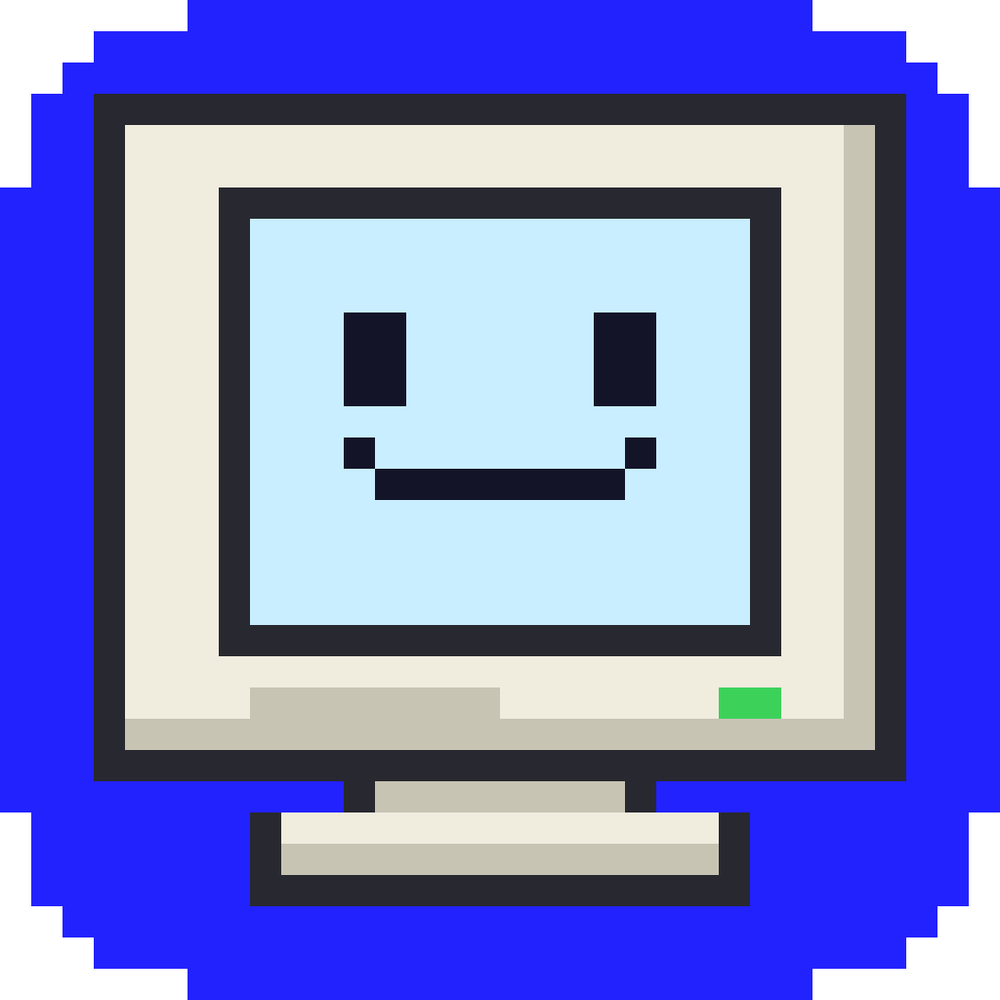
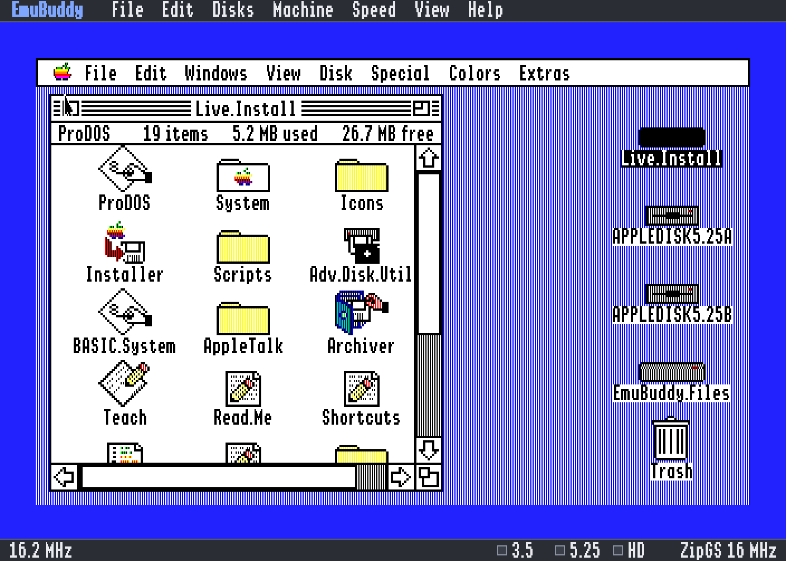
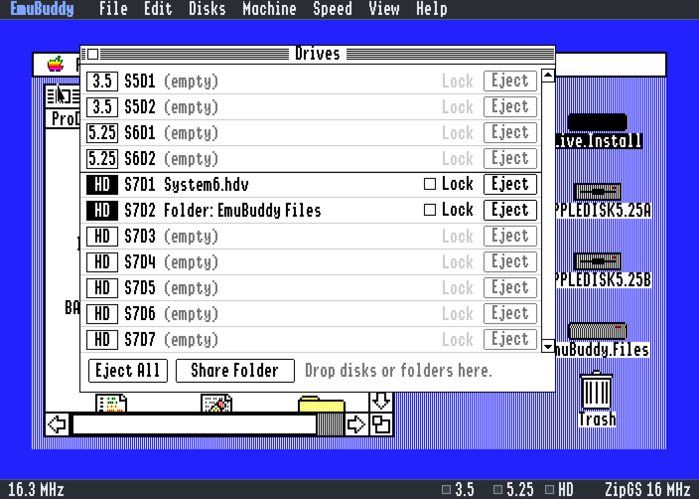
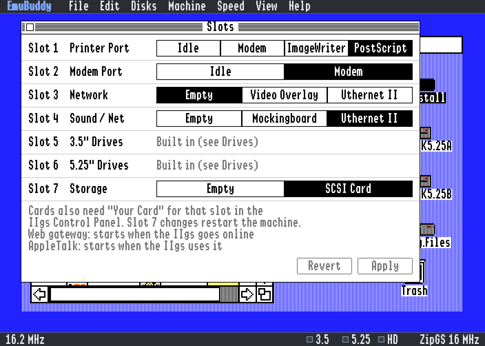
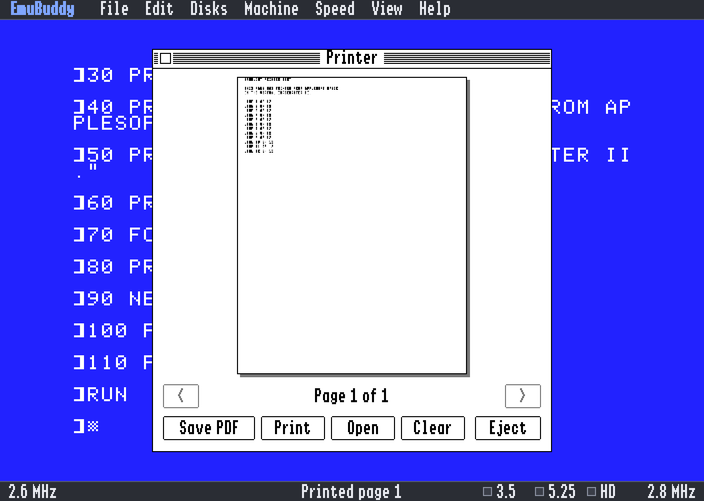
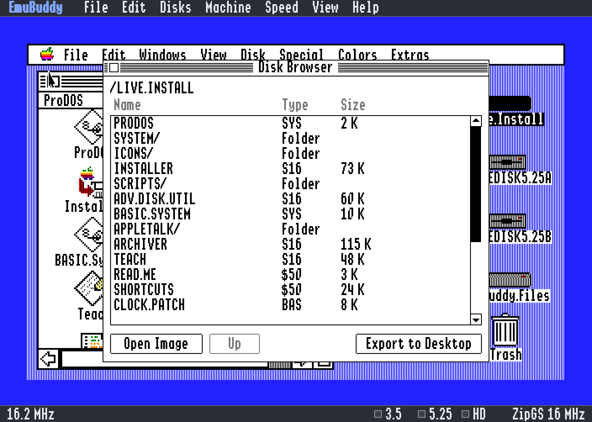
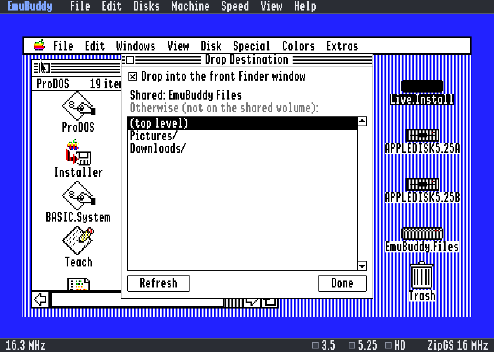
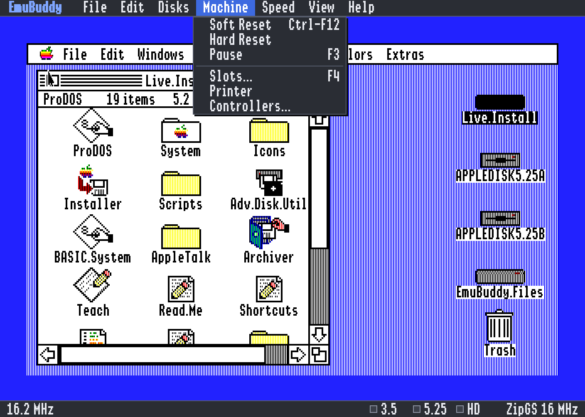

<p align="center">
  
</p>

<h1 align="center">EmuBuddy</h1>

<p align="center">
  <b>An Apple IIgs emulator you run with the mouse.</b><br>
  Menus, windows, drag and drop, printing, internet and file exchange with your computer, all without typing a command.
</p>



EmuBuddy is built on [KEGS](http://kegs.sourceforge.net), Kent Dickey's Apple IIgs emulator, through the
[GSplus](https://github.com/digarok/gsplus) SDL3 build. The emulator core is the proven KEGS one. What EmuBuddy adds is
everything around it: a menu bar and windows drawn in the look of the GS/OS desktop, easy disk handling, a printer,
network access, and several ways to move files between the IIgs and the computer it runs on.

It runs on **macOS (Apple Silicon)**, **Windows (x64)** and **Linux (x64 and arm64)**, and looks the same on all of them.

## What you get

- **A real user interface.** Menus along the top, status bar along the bottom, and windows for drives, slots, the
  printer and more, all drawn by EmuBuddy itself in a white Apple IIgs style, so it looks the same on every system.
  On macOS you can switch to the **System** skin: the menus move to the normal macOS menu bar at the top of the
  screen and file choosers are the system's own (View > Skin).
- **Disks on the fly.** Drop a disk image on the window, or pick one in the Drives window, while the IIgs is running.
  Two 3.5" and two 5.25" drives, plus a SCSI card with seven hard disks. `.po`, `.2mg`, `.hdv`, `.dsk`, `.do`, `.woz`
  and more.
- **Shared folders.** A folder on your computer becomes a ProDOS disk that the IIgs can read and write. Files you
  drop on the emulator appear in it, and files the IIgs saves are ordinary files on your computer.
- **Internet.** An Uthernet II card with a built-in network, so Marinetti and TCP/IP programs get DHCP, DNS and a
  connection to the internet without any set-up on your side.
- **Printing.** Print from GS/OS to a virtual ImageWriter II or a PostScript printer. Pages appear in a preview
  window and can be saved as PDF or sent to a real printer.
- **Configurable slots.** Choose what sits in each slot in a window, not in a text file.
- **Speed.** From the stock 1 and 2.8 MHz up to the full speed of your computer, switchable at any time.
- **Screenshots and video.** One key saves a screenshot; another records an MP4 with sound.
- **Your keyboard.** German, French, Spanish and other keyboards type what their keys show.
- **A command line, too.** Every setting also works from the command line, in the style of MAME's `apple2gs`.

## Screenshots

| | |
|---|---|
|  |  |
| **Drives.** Floppies, a SCSI card with seven hard disks, shared folders. Drop disks or folders here. | **Slots.** Pick the card for each slot. The defaults suit internet access and printing. |
|  |  |
| **Printer.** Pages from the IIgs, ready to save as PDF, print or open. | **Disk Browser.** Look inside any ProDOS disk image and take files out. |
|  |  |
| **Drop Destination.** Files you drop go to the front Finder window, or to a folder you choose. | **Machine menu.** Soft and hard reset, pause, slots, printer. |

## Getting started

### 1. Get EmuBuddy

Prebuilt apps are built automatically for every change; look under the repository's
[Actions](../../actions) (for the latest build) and [Releases](../../releases) (for tagged versions). Or build it
yourself, see [Building from source](#building-from-source).

EmuBuddy's downloads are **not code-signed or notarized**, so your system blocks or warns about them the first time.
You have to allow them yourself:

- **macOS:** macOS marks downloaded apps as quarantined and refuses to open an app that is not notarized. Remove the
  mark once, after moving the app where you want it (for example into Applications):
  `xattr -dr com.apple.quarantine /Applications/EmuBuddy.app`. Right-clicking the app and choosing **Open** also works on
  some versions of macOS. Apps you build yourself are not quarantined.
- **Windows:** SmartScreen blocks unsigned downloads. Click **More info**, then **Run anyway**. Keep `SDL3.dll` next
  to the `.exe`.
- **Linux:** unpack the `.tar.gz` and run `EmuBuddy`. It needs the SDL3 library (`libsdl3` from your package manager); the file `README-linux.txt` in the package tells how.

### 2. Give it a ROM

Like every IIgs emulator, EmuBuddy needs an Apple IIgs ROM file. It is Apple's copyrighted firmware, so it cannot
be included. Without one, EmuBuddy shows a **ROM Required** window instead of a screen.

- **Which ROM:** a **ROM 03** file is 256 KB and is the usual choice. A **ROM 01** file is 128 KB and also works. The
  very first ROM (ROM 0) is not supported.
- **How to load it:** drop the file on the window, or choose it with **File > Choose ROM File...**. EmuBuddy
  remembers it. From the command line you can use `-rom <file>`.
- **Where to find one:** the cleanest way is to read the ROM out of an Apple IIgs you own. Otherwise it circulates
  widely as part of MAME's `apple2gs` set. EmuBuddy needs a plain ROM file, not a zip: if you only have the MAME
  files `341-0737` and `341-0748`, put them together into one file (`cat 341-0737 341-0748 > ROM03`).
- **Did it work?** If you see "Check startup device!", the ROM loaded fine. It just needs a disk.

### 3. Start something

Drop a disk image on the window, or open **Disks > Drives Window** (F2) and click a drive. The IIgs boots from the
first bootable disk, as a real one would. GS/OS system disks, games and hard disk images all work the same way.

## Using EmuBuddy

### Disks and drives

Open the **Drives** window with **F2**. It lists every drive: 3.5" in slot 5, 5.25" in slot 6 and the seven drives of the
SCSI card in slot 7. Click a drive to choose an image, drop an image on a row, or drop it anywhere on the emulator and
EmuBuddy picks the right drive from its size and type. Each row has a **Lock** box (write protect) and **Eject**.
Ejecting waits if the disk is busy, so you cannot pull a disk out in the middle of a write.

Hard disk images may contain several partitions; EmuBuddy asks which one to use. The **Disks** menu also keeps a list
of recently used disks.

### Files between the IIgs and your computer

There are four ways, from the simplest to the most flexible:

1. **The automatic shared folder.** On the first start EmuBuddy makes a folder **EmuBuddy Files** in your Documents folder
   and mounts it as the disk `EmuBuddy.Files`, so file exchange works with no set-up. Switch this off with
   **Disks > Mount Shared Folder at Start**. **Share a Folder...** (or dropping a folder on the window) shares another
   folder the same way: it appears as a ProDOS disk. It is live: what the IIgs saves is a normal file in the folder, and a file you put in the
   folder shows up in the IIgs. **Disks > Show Shared Folder** opens the folder in your file manager.
2. **Drop files on the emulator.** Drop any file on the window and it is copied into the shared folder. If the front
   window of the GS/OS Finder shows the shared disk or one of its folders, the file goes **into exactly that
   folder**. If it shows a folder on another disk, EmuBuddy stages the file and a small background helper in the
   IIgs copies it into that folder by itself. At the first start EmuBuddy asks once whether it may install the helper
   in your startup disk (one file in `SYSTEM/SYSTEM.SETUP`, which you can delete at any time); see
   [docs/BRIDGE.md](docs/BRIDGE.md). Otherwise it goes where **Disks > Drop Destination...** says. ShrinkIt archives (`.shk`) are files, so
   they are copied, not mounted. Disk images are mounted in a drive instead.
3. **Disk Browser.** **Disks > Disk Browser** opens any ProDOS image (also one that is in a drive) and lists its
   files and folders with type and size. Choose **Export to Desktop**, or on macOS drag a file out of the window to
   the Finder.
4. **The host bridge.** A program inside the IIgs can read and write one folder of your computer directly. See
   [docs/BRIDGE.md](docs/BRIDGE.md). It is for tools such as file managers and is off until you choose a folder
   with **Disks > Bridge Folder...**.

**File types.** ProDOS files have a type and an aux type that a normal file system does not. EmuBuddy keeps them in the
file name: `GAME,t$B3,a$DB03` is a type $B3 file with aux type $DB03, `NOTES.txt` is a text file, and a name
with neither is a binary file. Files that have a resource fork are saved as AppleSingle (`.applesingle`).
The same convention is used everywhere, so a file can travel in both directions without losing its type.

### Slots

**Machine > Slots...** (F4) shows the seven slots. Choose a card for each and press **Apply**.

| Slot | Choices |
|---|---|
| 1 Printer port | Idle, Modem, ImageWriter (a printer), PostScript (a PostScript printer) |
| 2 Modem port | Idle, Modem (a virtual modem for telnet and BBS programs) |
| 3 | Empty, Video Overlay Card, Uthernet II |
| 4 | Empty, Mockingboard, Uthernet II |
| 5, 6 | The built-in disk drives (see Drives) |
| 7 | Empty, SCSI card (seven hard disks) |

The defaults are the Uthernet II in slot 4 and a PostScript printer on port 1, because that is what internet access and
printing need. As on the real machine, a card also needs "Your Card" selected for its slot in the IIgs Control
Panel. Changing slot 7 restarts the machine.

### Internet

The **Uthernet II** card gives the IIgs a network. EmuBuddy provides the other end, a built-in virtual network with
DHCP and DNS, so programs that use the **Marinetti** TCP/IP stack (select the Uthernet II link layer in its Control
Panel) get an address and can reach the internet, other computers on your network, and servers like web, FTP and SMB.
Nothing has to be installed or configured on your computer. The status bar shows how many packets went out and came in.

The virtual network is 192.168.64.0/24; the IIgs gets an address from .2 on, and the gateway and DNS server are .1.

### Printing

EmuBuddy has two virtual printers. Pick one for slot 1 in the Slots window. Every page lands in the **Printer** window
(**Machine > Printer**), where you can flip through the pages, **Save PDF**, **Print** on a real printer, **Open** the
PDF in your viewer, **Clear** the pages or **Eject** the page that is still being printed.

- **ImageWriter II.** Choose the *ImageWriter* printer driver in GS/OS and the ImageWriter port. This is the dot
  matrix printer most IIgs software supports; Applesoft `PR#1` prints on it too.
- **PostScript.** In the GS/OS **DC Printer** control panel, choose the printer port and the printer type
  **DC.PostScript**. The pages are drawn by [Ghostscript](https://ghostscript.com), which EmuBuddy finds itself
  (if it is missing, a window explains how to install it, and the print job waits). **Save PDF** then writes a
  sharp, small vector PDF instead of a picture of the page.

### Speed

The **Speed** menu changes the processor speed at any moment: the stock **1.0 MHz** and **2.8 MHz**, a ZipGS
accelerator at **8, 16, 32, 64 or 128 MHz**, or **Unlimited**, which runs as fast as your computer allows. The status
bar shows the real speed.

### Display

**View > Skin** (macOS) chooses the look: *IIgs Style* draws the menu bar inside the window; *System* uses the real
macOS menu bar and the system's file and folder choosers, and the window gets 20 points shorter. The tool windows
(Drives, Slots, Printer and so on) are drawn in the IIgs style in both skins.

**View > Window Size** offers 1x, 2x, 3x and 4x (sizes that do not fit your screen are greyed out), **Full Screen**
(F11), a curved **CRT Effect** (Ctrl-F11) and **Scanlines** (Shift-F11). The picture is always scaled evenly, so pixels
stay square.

### Screenshots and video

In the **File** menu:

- **Save Screenshot** (F10) saves the IIgs picture to your Pictures folder.
- **Save Window Screenshot** (Shift-F10) saves the whole window, with menu bar and windows.
- **Record Video** (Ctrl-F10) starts and stops an MP4 recording with sound, saved in your Movies folder. The status
  bar shows REC and the time. Recording needs [FFmpeg](https://ffmpeg.org) (if it is missing, a window shows how to
  get it). Quitting while recording saves the file.

### Keyboard

EmuBuddy passes the character your keyboard makes to the IIgs, so a German, French or Spanish keyboard types what
its keys show, whatever layout is set in the IIgs Control Panel. Umlauts and accents work in the desktop (EmuBuddy
types them the Mac way, with Option dead keys) and on the text screens (as the IIgs national characters). The **Edit**
menu can **Paste Text** from your clipboard into the IIgs and **Copy Screen Text** from a text screen back out.

| Key | Action |
|---|---|
| F1 | Open-Apple, for keyboards without an Apple key (the left Command key works as well) |
| F2 | Drives window |
| F3 | Pause |
| F4 | Slots window |
| F10, Shift-F10, Ctrl-F10 | Screenshot, window screenshot, start or stop video recording |
| F11, Shift-F11, Ctrl-F11 | Full screen, scanlines, CRT effect |
| Ctrl-F12 | Soft reset (like Ctrl-Reset on a real IIgs) |

The **Machine** menu has a **Soft Reset**, which restarts the machine but keeps the memory, like Ctrl-Reset, and a
**Hard Reset**, which also wipes the memory and reloads the ROM, like switching it off and on.

## EmuBuddy Launcher

The download holds a second program, **EmuBuddy Launcher**. It keeps several **profiles**, for example one for web
apps, one for your own projects and one for games. A profile holds the whole set-up: ROM, memory, speed, every slot,
the disks in the drives, the shared folder and the window. **Play** starts EmuBuddy with the matching command line
(see [Command line](#command-line)); the launcher shows that line, so you can use it in your own scripts.

- A **library** of your ROMs and disk images: you name the folders, the launcher lists what it finds with disk type
  and ProDOS volume name, shows which profile uses each file, and can check for copies and damaged images. A profile
  can use a **private copy** of a disk so the original stays as it is.
- **Skins:** Retro, Modern, Magazine, MacOS 1, MacOS 7, Terminal Amber, Apple II, Commodore 64, ZX Spectrum, Amstrad
  CPC, NeXT, BeOS, Retro Neon, Shelf and Cover Flow. The computer skins use the matching font (Apple II: PR Number 3,
  Commodore 64: Pet Me 64, ZX Spectrum: ZX Spectrum-7, Amstrad CPC: Amstrad CPC464). Every profile has a cover, your own
  picture or a generated one.

The plan and details are in [docs/LAUNCHER_PLAN.md](docs/LAUNCHER_PLAN.md).

## Command line

Everything above also works from the command line, in the style of MAME's `apple2gs`. The options last for one
run, unless you add `-save`.

```sh
EmuBuddy apple2gs -rom ROM03 -hard1 System6.hdv -sl4 uthernet2 -mhz 16 -scale 2 -share ~/IIgsFiles
```

On macOS the program is `EmuBuddy.app/Contents/MacOS/EmuBuddy`. `EmuBuddy -help` lists all options, and
[docs/CLI.md](docs/CLI.md) describes them, with notes on screenshots, recording, keyboard layouts and dropping files.

## Building from source

EmuBuddy builds with CMake. SDL3 is used if it is installed and built from source otherwise. From the repository root:

```sh
cmake -G Ninja -B build -S emubuddy/src
cmake --build build --target gsplus-sdl
```

This produces `build/EmuBuddy.app` (macOS), `build/EmuBuddy` (Linux) or `build/EmuBuddy.exe` (Windows, with
`SDL3.dll` next to it).

**macOS** (Homebrew and the Xcode command line tools): `brew install cmake ninja sdl3 libslirp`

**Linux** (Debian or Ubuntu): `sudo apt install cmake ninja-build build-essential git libslirp-dev` and the X11,
Wayland, audio and graphics development packages that SDL3 needs; the list is in
[.github/workflows/build.yml](.github/workflows/build.yml).

**Windows** ([MSYS2](https://www.msys2.org/), MINGW64 shell):
`pacman -S git mingw-w64-x86_64-gcc mingw-w64-x86_64-cmake mingw-w64-x86_64-ninja`

`libslirp` is what gives the Uthernet II card its network. Without it EmuBuddy still builds, but the card has no
connection. Optional helper programs, which EmuBuddy only looks for when you use the feature: **Ghostscript**
(PostScript printing) and **FFmpeg** (video recording).

Tests (not built by default):

```sh
cmake --build build --target test_uthernet2 && build/test_uthernet2   # network card
cmake --build build --target test_bridge && build/test_bridge          # host bridge
```

## Status and plans

EmuBuddy is in active development. The core and the user interface are in daily use on macOS; Windows and Linux are
built and checked on every change but have had much less hands-on testing. Known gaps and plans, in
[PLAN.md](PLAN.md):

- Disk sets (named groups of disks and a speed that open together).
- Writing files into a disk image from the Disk Browser, and dragging files out on Windows and Linux.
- The Uthernet II's hardware sockets (today the card works in the raw packet mode that Marinetti uses).
- Resource forks and more commands in the host bridge, and a matching "Mac folder" pane in GS Commander.
- An AppImage for Linux. (There are no plans for signed or notarized downloads: they need a paid developer account.)

## Credits and license

EmuBuddy is by **Walter Tengler**, 2026 ([portwally](https://github.com/portwally)). It is free software under the **GNU General Public
License, version 3** (see [LICENSE](LICENSE)).

- **KEGS**, the Apple IIgs emulator at the heart of this program, is by Kent Dickey.
- **GSplus** by Dagen Brock (digarok) brought KEGS to SDL3 and to macOS, Windows and Linux; EmuBuddy starts from it.
- The **ImageWriter II** emulation comes from the GSport and GSplus line of emulators (originally from DOSBox).
- The **Shaston** font used for the menus and windows is the IIgs system font.
- **SDL3** for windows, input and sound, and **libslirp** for the virtual network.
- **Ghostscript** and **FFmpeg** are separate programs that EmuBuddy calls when you print PostScript or record
  video; they are not part of EmuBuddy and come under their own licenses.

Apple, Apple IIgs, GS/OS and ImageWriter are trademarks of Apple Inc. EmuBuddy is not affiliated with Apple.
